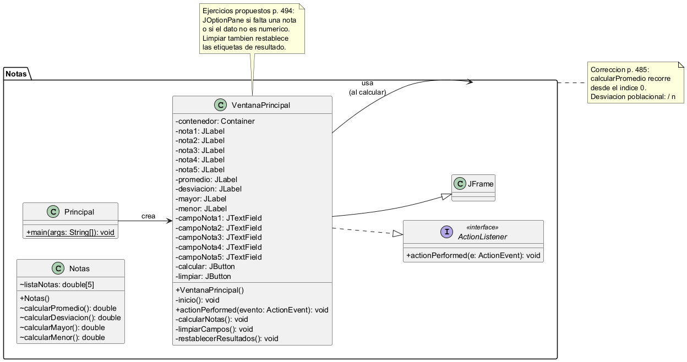
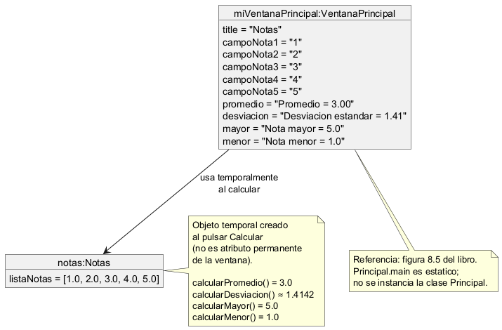
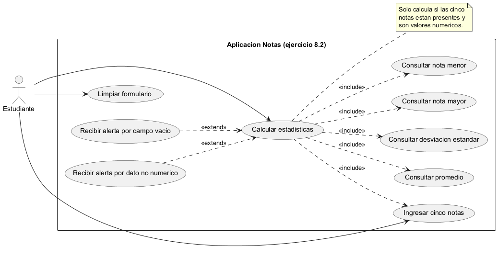

# Ejercicio 8.2 — Componentes Swing (notas)

**Libro:** Leonardo Bermón Angarita, *Ejercicios de programación orientada a objetos con Java y UML*.  
**Páginas impresas:** 480–494. Enunciado en la página 483; solución en 485–492; ejercicios propuestos en la 494.

## Objetivo

Programa con interfaz gráfica Swing que pide cinco notas y muestra el promedio, la desviación estándar poblacional, la nota mayor y la nota menor.

## Archivos

| Archivo | Descripción |
| --- | --- |
| `src/Notas/Notas.java` | Array de cinco notas y métodos de cálculo |
| `src/Notas/VentanaPrincipal.java` | Ventana Swing y eventos |
| `src/Notas/Principal.java` | Punto de entrada (`main`) |
| `uml/` | Diagramas de clases, objetos y casos de uso |
| `evidencias/` | Capturas reales de la interfaz |

Los identificadores van sin tildes (`calcularDesviacion`, etiqueta `Desviacion`) para facilitar la compilación. En el libro aparecen como `calcularDesviación` / `Desviación`.

## Correcciones respecto al libro

1. `calcularPromedio()` recorre desde el índice **0**. En la página 485 el ciclo empezaba en `i = 1` y omitía la primera nota.
2. La desviación estándar divide por **n = 5** (poblacional), como indica la solución del libro, no por 4.
3. Validación de datos de los ejercicios propuestos (p. 494).
4. El botón **Limpiar** también restablece las etiquetas de resultado (mejora respecto al libro, que solo vaciaba los campos de texto).

## Ejercicios propuestos (p. 494)

1. Alerta con `JOptionPane` si algún valor no es numérico (incluye `NaN`, `Infinity` y `-Infinity`, rechazados con `Double.isFinite()`).
2. Alerta si falta una o varias de las cinco notas.

En ambos casos no se calculan resultados. Al pulsar **Calcular**, las etiquetas de resultado se restablecen primero, para que un intento inválido no deje valores de un cálculo anterior. No se impone un rango de calificaciones: el enunciado no lo define.

## Compilar y ejecutar

Desde `ejercicio_8_2`, con JDK 21:

```text
javac -encoding UTF-8 -d out src/Notas/*.java
java -cp out Notas.Principal
```

Sin Maven ni dependencias externas.

## Prueba de referencia

Con notas 1, 2, 3, 4 y 5:

| Métrica | Valor |
| --- | --- |
| Promedio | 3.00 |
| Desviación estándar | ≈ 1.41 |
| Nota mayor | 5.0 |
| Nota menor | 1.0 |

Con cinco notas iguales, la desviación es 0.

## Diagramas UML

### Diagrama de clases



Fuente: [uml/diagrama_clases.puml](uml/diagrama_clases.puml)

### Diagrama de objetos



Fuente: [uml/diagrama_objetos.puml](uml/diagrama_objetos.puml)

### Casos de uso



Fuente: [uml/casos_uso.puml](uml/casos_uso.puml)

## Evidencias

| Archivo | Contenido |
| --- | --- |
| [evidencias/01_ventana_inicial.png](evidencias/01_ventana_inicial.png) | Ventana vacía al iniciar |
| [evidencias/02_calculo_correcto.png](evidencias/02_calculo_correcto.png) | Cálculo con notas 1–5 |
| [evidencias/03_alerta_campo_vacio.png](evidencias/03_alerta_campo_vacio.png) | Alerta por nota faltante |
| [evidencias/04_alerta_dato_no_numerico.png](evidencias/04_alerta_dato_no_numerico.png) | Alerta por dato no numérico |
