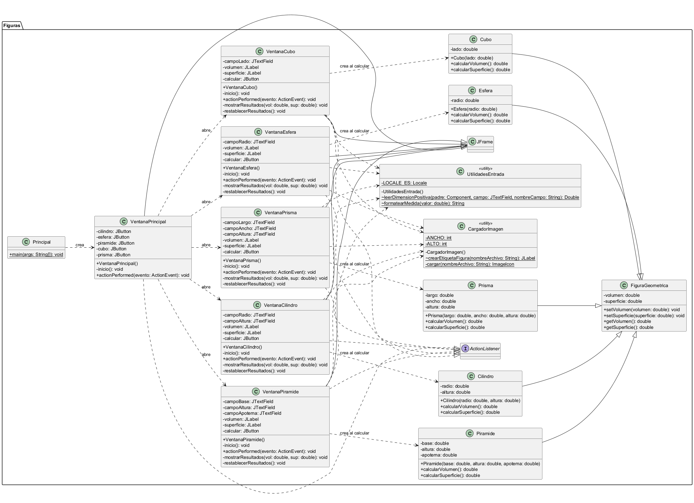
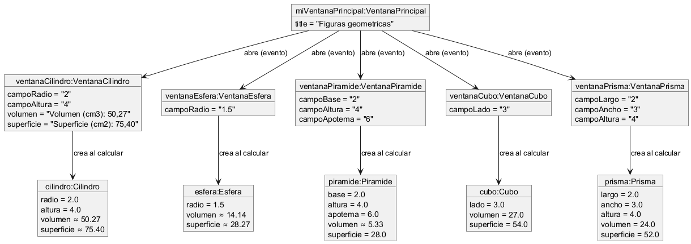
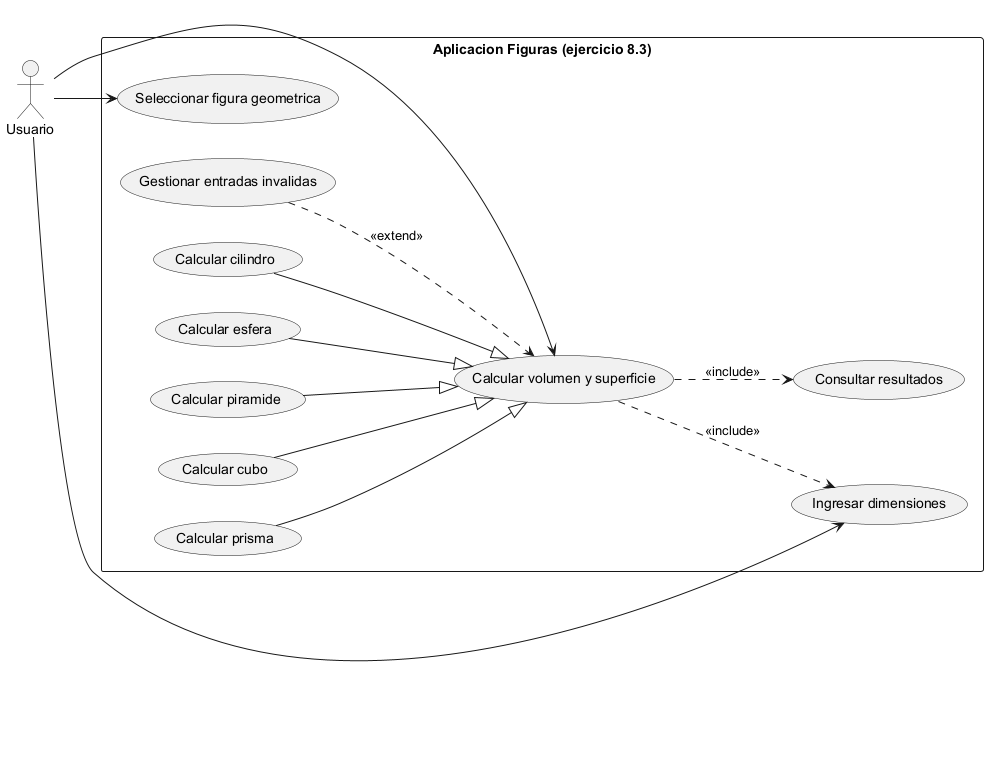

# Ejercicio 8.3 — Gestión de eventos (figuras geométricas)

**Libro:** Leonardo Bermón Angarita, *Ejercicios de programación orientada a objetos con Java y UML*.  
**Páginas impresas:** 494–517. Enunciado en la 495; solución en 497–514; diagramas y ejercicios propuestos en 515–517.

## Objetivo

Aplicación Swing que calcula el volumen y la superficie total de figuras tridimensionales. Usa herencia desde `FiguraGeometrica`, ventanas independientes por figura y `ActionListener` para gestionar los eventos.

## Clases

| Clase | Rol |
| --- | --- |
| `FiguraGeometrica` | Superclase con `volumen` y `superficie` |
| `Cilindro`, `Esfera`, `Piramide` | Figuras del enunciado original |
| `Cubo`, `Prisma` | Figuras de los ejercicios propuestos |
| `VentanaPrincipal` | Menú con cinco botones |
| `VentanaCilindro` … `VentanaPrisma` | Formularios, imagen y cálculo |
| `Principal` | Punto de entrada (`main` + `SwingUtilities.invokeLater`) |

La herencia concentra volumen y superficie en la clase padre. Cada subclase define sus dimensiones, calcula en el constructor y guarda los resultados con `setVolumen` / `setSuperficie`.

Los eventos se atienden en `actionPerformed`: se validan las entradas, se crea el objeto geométrico y se muestran los resultados. Las ventanas de figura usan `DISPOSE_ON_CLOSE`; la principal, `EXIT_ON_CLOSE`.

Los valores se presentan con dos decimales y locale `es-ES` (`UtilidadesEntrada.formatearMedida`). Si el cálculo produce `Infinity` o `NaN` por desbordamiento, se limpian los resultados y se muestra una alerta; los campos de entrada no se modifican.

## Fórmulas

| Figura | Entradas | Volumen | Superficie |
| --- | --- | --- | --- |
| Cilindro | radio, altura | π r² h | 2π r h + 2π r² |
| Esfera | radio | (4/3) π r³ | 4π r² |
| Pirámide (base cuadrada) | base (lado), altura, apotema | (base² · altura) / 3 | base² + 2 · base · apotema |
| Cubo | lado | lado³ | 6 · lado² |
| Prisma rectangular | largo, ancho, altura | largo · ancho · altura | 2 (lw + lh + wh) |

El apotema de la pirámide lo ingresa el usuario, como en el libro. El prisma se modeló como **rectangular** porque el enunciado propuesto no indica el tipo.

## Ejercicios propuestos (p. 517)

1. Cubo y prisma rectangular, con sus ventanas y botones en el menú.
2. Imagen de cada figura en `resources/figuras/`, mostrada con `ImageIcon` / `JLabel`.

## Correcciones respecto al libro

1. Volumen de la esfera con `4.0 / 3.0` (el libro usa `1.333`). Con radio 1,5 el volumen es ≈ 14,14 cm³; la figura 8.9 muestra ≈ 14,13 por esa aproximación.
2. Identificadores sin tildes (`Piramide`, `FiguraGeometrica`).
3. Comentario mal cerrado de `altura` en `Piramide` (p. 500) no se reprodujo.
4. `DISPOSE_ON_CLOSE` en ventanas secundarias; validaciones de vacío, no numérico, no finito y dimensión ≤ 0.
5. Al calcular se limpian resultados previos si la validación falla.

## Compilar y ejecutar

Desde `ejercicio_8_3`, con JDK 21:

```text
javac -encoding UTF-8 -d out src/Figuras/*.java
java -cp "out;resources" Figuras.Principal
```

En Linux/macOS usar `out:resources` en el classpath. Las imágenes se buscan en el classpath (`figuras/*.png`) o en `resources/figuras/`. Si falta una imagen, la ventana muestra un aviso de texto y el programa sigue.

## Ejemplos de resultados

| Figura | Datos | Volumen | Superficie |
| --- | --- | --- | --- |
| Cilindro | r=2, h=4 | ≈ 50,27 cm³ | ≈ 75,40 cm² |
| Esfera | r=1,5 | ≈ 14,14 cm³ | ≈ 28,27 cm² |
| Pirámide | b=2, h=4, a=6 | ≈ 5,33 cm³ | 28,00 cm² |
| Cubo | lado=3 | 27,00 cm³ | 54,00 cm² |
| Prisma | 2×3×4 | 24,00 cm³ | 52,00 cm² |

## Diagramas UML

### Diagrama de clases



Fuente: [uml/diagrama_clases.puml](uml/diagrama_clases.puml)

### Diagrama de objetos



Fuente: [uml/diagrama_objetos.puml](uml/diagrama_objetos.puml)

### Casos de uso



Fuente: [uml/casos_uso.puml](uml/casos_uso.puml)

## Evidencias

| Archivo | Contenido |
| --- | --- |
| [evidencias/01_ventana_principal.png](evidencias/01_ventana_principal.png) | Menú con cinco figuras |
| [evidencias/02_cilindro.png](evidencias/02_cilindro.png) | Cilindro r=2, h=4 |
| [evidencias/03_esfera.png](evidencias/03_esfera.png) | Esfera r=1,5 |
| [evidencias/04_piramide.png](evidencias/04_piramide.png) | Pirámide 2, 4, 6 |
| [evidencias/05_cubo.png](evidencias/05_cubo.png) | Cubo lado=3 |
| [evidencias/06_prisma.png](evidencias/06_prisma.png) | Prisma 2×3×4 |
| [evidencias/07_alerta_campo_vacio.png](evidencias/07_alerta_campo_vacio.png) | Campo vacío |
| [evidencias/08_alerta_dato_invalido.png](evidencias/08_alerta_dato_invalido.png) | Dato no numérico |
| [evidencias/09_alerta_dimension_no_positiva.png](evidencias/09_alerta_dimension_no_positiva.png) | Dimensión ≤ 0 |
